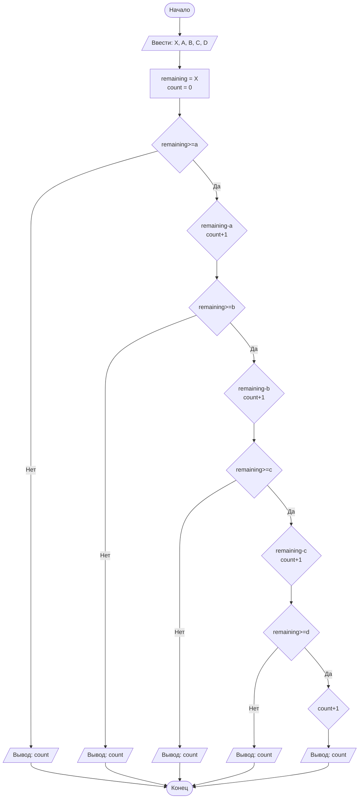

## Отчет по лабораторной работе № 1

#### № группы: `ПМ-2601`

#### Выполнил: `Резниченко Полина`

#### Вариант: `20`

### Cодержание:

- [Постановка задачи](#1-постановка-задачи)
- [Входные и выходные данные](#2-входные-и-выходные-данные)
- [Математическая модель](#25-математическая-модель)
- [Выбор структуры данных](#3-выбор-структуры-данных)
- [Алгоритм](#4-алгоритм)
- [Программа](#5-программа)
- [Анализ правильности решения](#6-анализ-правильности-решения)

### 1. Постановка задачи

- Условие задачи

> 4 покупателя стоят в очереди за бананами. Они планируют купить `A`, `B`, `C`, `D`
> килограмм бананов соответственно порядку в очереди (или все оставшиеся, если к
> моменту обслуживания покупателя в магазине остается меньше бананов, чем планирует
> купить покупатель). Изначально в магазине имеется `X` кг бананов. Сколько
> покупателей смогут купить бананы, которые они планируют? На вход программы подаются
> натуральные числа `X`, `A`, `B`, `C`, `D`.

- Как я понимаю задачу

Покупатели обслуживаются строго по порядку очереди. Каждый очередной покупатель
хочет унести ровно свой запланированный объем бананов. Возможны две ситуации:

1. Бананов в магазине **достаточно** (оставшийся объем `≥` плана покупателя) —
   покупатель забирает запланированный объём, остаток уменьшается, а сам покупатель
   считается «успешным».
2. Бананов в магазине **не хватает** (оставшийся объём `<` плана покупателя) —
   покупатель забирает *все* оставшиеся бананы. Это меньше, чем он планировал, значит
   он **не** купил то, что хотел, и «успешным» не считается. После этого магазин
   становится пустым.

Нужно посчитать количество покупателей, которые унесли **ровно** свой
запланированный объем.

Важное следствие из условия: объемы — **натуральные** числа, то есть каждый план
`≥ 1`. Поэтому как только у очередного покупателя не хватило бананов, магазин
опустошается (остается `0` кг), и все последующие покупатели заведомо не смогут
купить свое (ведь им нужно хотя бы `1` кг). Значит, ответ — это длина начального
«успешного» отрезка очереди.

Пример: `X = 30`, планы `10 10 10 1`.
- 1-й покупатель: остаток `30 ≥ 10` → покупает, остаток `20`, успешных `1`.
- 2-й покупатель: остаток `20 ≥ 10` → покупает, остаток `10`, успешных `2`.
- 3-й покупатель: остаток `10 ≥ 10` → покупает, остаток `0`, успешных `3`.
- 4-й покупатель: остаток `0 < 1` → забирает `0` кг, свой план не выполнил.

Ответ: `3`.

### 2. Входные и выходные данные

#### Данные на вход

На вход подается 5 **натуральных** чисел: `X` — начальное количество бананов и
`A`, `B`, `C`, `D` — планы четырех покупателей. Натуральное число — это целое
положительное число, поэтому для хранения подходит целочисленный тип. В условии
верхняя граница явно не задана, поэтому берем безопасный практический предел бананов, которые могут уместиться в среднестатистическом магазине
10<sup>6</sup>, который заведомо помещается в 32-битный знаковый `int`
(10<sup>6</sup> < 2<sup>31</sup> - 1 ≈ 2.147 · 10<sup>6</sup>). Промежуточные вычисления — только вычитание из
остатка, которое не выходит за пределы `X`, поэтому переполнение невозможно.

|                | Тип           | min значение | max значение   |
|----------------|---------------|--------------|----------------|
| `X` (в магазине) | Целое число   | 1            | 10<sup>6</sup> |
| `A` (покупатель 1) | Целое число   | 1            | 10<sup>6</sup> |
| `B` (покупатель 2) | Целое число   | 1            | 10<sup>6</sup> |
| `C` (покупатель 3) | Целое число   | 1            | 10<sup>6</sup> |
| `D` (покупатель 4) | Целое число   | 1            | 10<sup>6</sup> |

#### Данные на выход

На выход программа выдает единственное целое неотрицательное число — количество
покупателей, купивших запланированный объем. Так как покупателей всего 4, результат
лежит в диапазоне от `0` (никто не смог) до `4` (все смогли).

|         | Тип                                | min значение | max значение |
|---------|------------------------------------|--------------|--------------|
| Ответ   | Целое неотрицательное число        | 0            | 4            |

### 2,5. Математическая модель

Обозначим план `i`-го покупателя как p<sub>i</sub> (где p<sub>1</sub> = A, p<sub>2</sub> = B, p<sub>3</sub> = C,
p<sub>4</sub> = D). Введём остаток бананов после обслуживания первых `i` покупателей r<sub>i</sub>:

- r<sub>i</sub> = X;
- если r<sub>i-1</sub> ≥ <sub>i</sub>, то покупатель `i` успешен и r<sub>i</sub> = r<sub>i-1</sub> - p<sub>i</sub>;
- иначе покупатель `i` неуспешен и r<sub>i</sub> = 0 (забрал все, что было).

Так как все p<sub>i</sub> ≥ 1, после первого неуспешного покупателя `r = 0`, и ни один
следующий покупатель не сможет купить свое. Поэтому искомый ответ равен количеству
подряд идущих с начала очереди покупателей, для которых выполняется
r<sub>i-1</sub> ≥ p<sub>i</sub>. Иначе говоря, это наибольшее `k` (от 0 до 4), при котором сумма
первых `k` планов не превосходит `X`: p<sub>1</sub> + p<sub>2</sub> + ... + p<sub>k</sub> ≤ X.

### 3. Выбор структуры данных

Для работы программе нужно хранить начальное количество бананов и четыре плана
покупок. Все значения — натуральные числа до 10<sup>6</sup>, что укладывается в тип `int`
(10<sup>6</sup> < 2<sup>31</sup> - 1), поэтому использовать `long` или вещественные типы избыточно.

Чтобы обработать всех покупателей единообразно и не дублировать код `if` для каждого
из них, планы покупок удобно сложить в **массив** `int[] plans` в порядке очереди и
пройти по нему циклом. Это делает решение компактным и легко расширяемым (если бы
покупателей было не 4, а больше). Дополнительно нужны две переменные: `remaining` —
текущий остаток бананов, и `count` — счетчик успешных покупателей.

|                       | название переменной | Тип (в Java) |
|-----------------------|---------------------|--------------|
| Бананы в магазине     | `x`                 | `int`        |
| Планы покупателей     | `plans`             | `int[]`      |
| Текущий остаток       | `remaining`         | `int`        |
| Счётчик успешных      | `count`             | `int`        |

### 4. Алгоритм

#### Алгоритм выполнения программы:

1. **Ввод данных.** Программа считывает натуральное число `X` (бананы в магазине) и
   четыре натуральных числа `A`, `B`, `C`, `D` (планы покупателей в порядке очереди).

2. **Подготовка.** Заводятся переменные: остаток `remaining = X` и счётчик успешных покупателей `count = 0`.

3. **Обслуживание очереди.** Для каждого покупателя по порядку:
   - если остатка хватает (`remaining ≥ a`), покупатель забирает запланированный
     объем: остаток уменьшается (`remaining = remaining − a`), счетчик
     увеличивается (`count = count + 1`). Далее по этой же аналогии с последующими покупателями;
   - иначе бананов не хватает: покупатель уносит все, что осталось, магазин пустеет.
     Так как все планы покупателей `≥ 1`, дальше никто купить не сможет, поэтому выводим количество `count` успешных покупателей;

4. **Вывод результата.** Программа выводит значение `count` — количество покупателей,
   купивших ровно то, что планировали.

#### Блок-схема



### 5. Программа

```java
import java.io.PrintStream;
import java.util.Scanner;

/**
 * Лабораторная работа № 1. Вариант 20.
 *
 * За бананами в очереди стоят 4 покупателя. Они планируют купить
 * A, B, C, D килограммов бананов (в порядке очереди). Если к моменту
 * обслуживания покупателя в магазине осталось меньше бананов, чем он
 * планирует, покупатель забирает все оставшиеся бананы (и, значит, НЕ
 * получает запланированный объём). Изначально в магазине X кг бананов.
 *
 * Программа определяет, сколько покупателей смогут купить ровно тот
 * объём бананов, который они планировали.
 */
public class Main {
    // Объект Scanner для чтения входных данных из стандартного потока ввода
    public static Scanner in = new Scanner(System.in);
    // Объект PrintStream для вывода результата в стандартный поток вывода
    public static PrintStream out = System.out;

    public static void main(String[] args) {
        // Считываем начальное количество бананов в магазине (в килограммах)
        int x = in.nextInt();

        // Считываем планируемые объёмы покупки четырёх покупателей (в кг)
        // именно в том порядке, в котором они стоят в очереди
        int a = in.nextInt();
        int b = in.nextInt();
        int c = in.nextInt();
        int d = in.nextInt();

        // remaining — сколько бананов сейчас осталось в магазине
        int remaining = x;
        // count — сколько покупателей купили РОВНО столько, сколько планировали
        int count = 0;
        // Обслуживаем покупателей строго по очереди
        if (remaining>=a){
            remaining-= a;
            count++;
            //Если бананов осталось достаточно, вычитаем из общего остатка то кол-во, которое забрал покупатель
            //Увеличиваем счётчик довольных покупателей
            if (remaining>=b) {
                remaining -= b;
                count++;
                if (remaining >= c) {
                    remaining -= c;
                    count++;
                    if (remaining >= d) {
                        count++;
                        out.println(count);
                    } else {
                        out.println(count);
                        //На последнем покупателе выводим ответ, вне зависимости от того, посчитали ли мы его
                    }
                } else {
                    out.println(count);
                    //Если до четвертого покупателя не дошли, выведем количество уже на третьем
                    //Далее по тому же принципу
                }
            }else{
                    out.println(count);
                }
        }else {
            out.println(count);
        }
    }
}
```

### 6. Анализ правильности решения

Тесты подобраны так, чтобы покрыть все качественно разные случаи: когда покупают
все, когда никто, когда обслуживание обрывается в середине очереди, а также
граничные ситуации (ровно хватает, самый первый не смог, предельные значения).

1. Тест «хватает всем» — бананов заведомо больше суммы планов, покупают все 4:

    - **Input**:
        ```
        100 10 20 30 40
        ```

    - **Output**:
        ```
        4
        ```

2. Тест «не хватило самому первому» — первый план больше, чем есть в магазине,
   очередь обрывается сразу:

    - **Input**:
        ```
        5 10 1 1 1
        ```

    - **Output**:
        ```
        0
        ```

3. Тест «обрыв в середине» — первым двоим хватает, третьему уже нет:

    - **Input**:
        ```
        25 10 10 10 10
        ```

    - **Output**:
        ```
        2
        ```

4. Тест «ровно хватает на троих» — граничный случай `remaining == plan` для третьего
   покупателя (остаток становится 0), четвёртому не хватает:

    - **Input**:
        ```
        30 10 10 10 1
        ```

    - **Output**:
        ```
        3
        ```

5. Тест на минимальные натуральные значения — хватает только первому:

    - **Input**:
        ```
        1 1 1 1 1
        ```

    - **Output**:
        ```
        1
        ```

6. Тест на ограничение задачи — предельные значения до 10<sup>9</sup>, сумма планов
   ровно равна `X`, покупают все 4:

    - **Input**:
        ```
        1000000000 250000000 250000000 250000000 250000000
        ```

    - **Output**:
        ```
        4
        ```

Во всех тестах фактический вывод программы совпал с ожидаемым, что подтверждает
корректность решения на всём множестве допустимых входных данных с учетом
ограничений.

# Критерии оценивания

Обратите внимание на то, что лабораторная работа должна быть выложена в отдельный репозиторий с названием LabN (N -
Номер лабы). В репозитории должно быть минимум 2 файла (README.md - отчет, Main.java - код лабы)

| **Критерий**                                                                                                                                                                           | **Баллы**       |
|----------------------------------------------------------------------------------------------------------------------------------------------------------------------------------------|-----------------|
| **Корректность программы**                                                                                                                                                             | **0** - **40**  |
| - Программа полностью выполняет задачу                                                                                                                                                 | 15              |
| - Нет ошибок выполнения                                                                                                                                                                | 10              |
| - Учтены все ограничения                                                                                                                                                               | 5               |
| - Правильное поведение в "крайних" случаях                                                                                                                                             | 10              |
|                                                                                                                                                                                        |                 |
| **Оптимизация кода**                                                                                                                                                                   | **0** - **20**  |
| - Эффективные алгоритмы                                                                                                                                                                | 10              |
| - Избежание избыточности и повторов                                                                                                                                                    | 5               |
| - Разумность использования структур данных                                                                                                                                             | 5               |
|                                                                                                                                                                                        |                 |
| **Читабельность и стиль кода**                                                                                                                                                         | **0** - **20**  |
| - Соблюдение стандартов форматирования                                                                                                                                                 | 5               |
| - Наличие комментариев, в полном объеме поясняющих написанный код                                                                                                                      | 10              |
| - Понятные имена переменных и функций                                                                                                                                                  | 5               |
|                                                                                                                                                                                        |                 |
| **Оформление отчета**                                                                                                                                                                  | **0** - **20**  |
| - Соблюдение структуры отчета                                                                                                                                                          | 5               |
| - Отчет загружен на GitHub в репозиторий с названием LabN (N - номер лабораторной работы), отчет в формате Markdown с названием README.md, также есть файл Main.java с кодом программы | Обязательно     |
| - Четкое описание алгоритма (блок-схема если нужна)                                                                                                                                    | 5               |
| - Полнота покрытия тестами всех случаев                                                                                                                                                | 5               |
| - Обоснования использования алгоритма, структур данных                                                                                                                                 | 5               |
|                                                                                                                                                                                        |                 |
| **Общая сумма**                                                                                                                                                                        | **0** - **100** |

